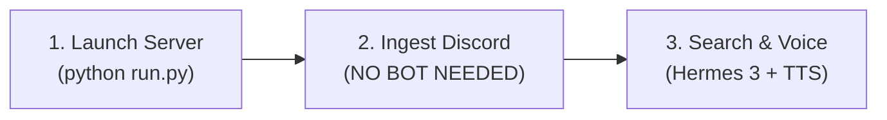

# ThreadLore 🎙️🔍

**Local-First Discord Chat Intelligence Dashboard & Live Voice Agent**  
*Agent Skill Open Standard Compliant • SQLite FTS5 BM25 Retrieval • Nous Hermes 3 RAG • ElevenLabs Voice Pipeline*

---

## 🌟 Key Features

1. **Deterministic 90-Day Conversation Search (SQLite FTS5 + BM25)**:
   - High-performance virtual table (`messages_fts`) linked directly to `messages` using SQLite external content table architecture (`content='messages'`, `content_rowid='rowid'`).
   - BM25 ranked scoring, snippet highlights with `<mark>` tags, and millisecond query latency.
   - Built-in multi-channel (`#dev-core`, `#research-hermes`, `#operations`, etc.) and multi-author filtering over a rolling 90-day archive window.

2. **DiscordChatExporter Automation**:
   - Automated message ingestion wrapper executing `DiscordChatExporter.Cli` via Python subprocess.
   - Computes rolling cutoff dates (`--after`), formats output into JSON, deduplicates records with `INSERT OR IGNORE`, and rebuilds FTS5 indices seamlessly.
   - Includes realistic sample archive generator for instant testing without needing Discord bot tokens.

3. **Live Voice-Call Mode (Interactive Full-Duplex Pipeline)**:
   - **Speech-to-Text (STT)**: Browser Web Speech API (`SpeechRecognition` / `webkitSpeechRecognition`) for continuous real-time input.
   - **Reasoning (LLM)**: Context-grounded retrieval using Nous Research Hermes 3 with concise voice-persona prompts.
   - **Text-to-Speech (TTS)**: ElevenLabs REST API integration (`eleven_turbo_v2_5` / `eleven_multilingual_v2`) with automatic graceful fallback to browser Web Speech Synthesis.
   - Visual audio waveform and stateful visualizer orb (Listening, Thinking, Speaking).

4. **Hermes 3 Conversational RAG Chat**:
   - Full conversational interface grounded in retrieved Discord message threads.
   - Expandable source citation drawers displaying exact channel, author, and timestamp provenance for all generated answers.

5. **Agent Skill Open Standard Specification**:
   - Fully documented agent skill in `skill/SKILL.md` for tool integration with AI agents.
   - Standalone CLI query & synthesis tool in `skill/scripts/query_vault.py` capable of table, JSON, and markdown output formats.

---

## 📁 Project Architecture

```
threadlore/
├── backend/
│   ├── main.py                  # FastAPI application, route handlers, RAG synthesis
│   ├── db.py                    # SQLite schema, FTS5 virtual table, BM25 90-day engine
│   ├── exporter.py              # DiscordChatExporter subprocess wrapper & sample seeder
│   ├── voice.py                 # ElevenLabs TTS REST API integration helper
│   ├── bin/
│   │   ├── DiscordChatExporter.Cli     # Unix shell launcher
│   │   ├── DiscordChatExporter.Cli.bat # Windows batch launcher
│   │   └── cli_runner.py        # DiscordChatExporter runner & mock simulator
│   └── data/
│       └── chat_vault.db        # Local SQLite database with FTS5 index
├── skill/
│   ├── SKILL.md                 # Agent Skill Open Standard specification
│   └── scripts/
│       └── query_vault.py       # Standalone CLI retrieval and synthesis script
├── frontend/
│   ├── index.html               # Responsive dashboard UI (Search, Voice Call, Chat, Exporter)
│   └── app.js                   # Web Speech API loop, FTS5 search UI, audio streaming
├── .env.example                 # Sample configuration template
├── .env                         # Active environment variables
├── requirements.txt             # Python dependencies
├── run.py                       # One-click startup script launching FastAPI
└── README.md                    # Documentation
```

---

## 🚀 Quick Start Guide

### 1. Prerequisites
- Python 3.11+
- Modern Web Browser (Chrome, Edge, Safari, or Firefox)

### 2. Installation
```bash
# Clone or navigate to the project directory
cd threadlore

# Create and activate virtual environment
python -m venv venv
# On Windows:
.\venv\Scripts\activate
# On Linux/macOS:
source venv/bin/activate

# Install dependencies
pip install -r requirements.txt
```

### 3. Launch ThreadLore
```bash
python run.py
```

The startup script will initialize the SQLite database, seed initial sample data if empty, and launch the web dashboard at **http://127.0.0.1:8000**.

---

## 🔍 Agent Skill CLI Tool (`skill/scripts/query_vault.py`)

Any agent or terminal script can directly search the 90-day vault without running the web server:

### Table Output:
```bash
python skill/scripts/query_vault.py --query "Hermes" --days 90 --format table
```

### JSON Output:
```bash
python skill/scripts/query_vault.py --query "release date" --format json
```

### Retrieval with LLM Synthesis:
```bash
python skill/scripts/query_vault.py --query "What is the deployment schedule?" --synthesize
```

---

## ⚡ Simplified Workflow: From Zero to Voice Call in 2 Minutes

You can initialize and run ThreadLore in 3 simple steps:



### Step 1: Start ThreadLore
```bash
python run.py
```
This starts the web dashboard at **http://127.0.0.1:8000** on port 8000.

### Step 2: Ingest Discord Chat Context (WITHOUT a Discord Bot)
Go to the **Exporter** tab in the dashboard. Choose either:
- **Drag & Drop JSON** (Easiest, no token needed)
- **Paste Personal User Token** (Direct automated export, no bot needed)
- **Click '1-Click Sample Archive'** (Instant demo)

### Step 3: Search & Talk
- **Vault Search**: Search keywords or ask natural questions over the last 90 days.
- **Live Voice Call**: Click "Start Voice Call" to talk hands-free with Hermes 3.
- **Hermes Chat**: Text-based RAG grounded in your team's archived messages.

---

## 🚫 How to Initialize Discord Chat Context WITHOUT a Bot

> **Why you don't need a bot**:  
> Most Discord skills force you to create a bot in the Discord Developer Portal and beg a server administrator to add it with message read permissions. **You almost never have admin rights on servers you care about.**  
> ThreadLore solves this completely. You have 3 bot-free ways to ingest Discord conversations:

### Method A: Drag & Drop JSON (Easiest — 100% Offline & No Token in ThreadLore)
1. Download the standalone, open-source [DiscordChatExporter GUI](https://github.com/Tyrrrz/DiscordChatExporter/releases) desktop app.
2. In DiscordChatExporter GUI, paste your personal user token once. It will list all servers and DMs you are a member of.
3. Select any channel you want to sift, choose **JSON** format, and export it.
4. In ThreadLore, go to the **Exporter** tab and simply **drag and drop the exported `.json` file into the upload zone**.
5. ThreadLore immediately parses all messages, normalizes timestamps, indexes them in SQLite FTS5, and rebuilds BM25 search rankings!

### Method B: Automated CLI Export Using Your Personal User Token
ThreadLore can run the export subprocess automatically using your personal user token:

#### 🕒 How to Get Your Personal User Token in 10 Seconds (Zero Admin Rights Needed):
1. Open Discord in your web browser (Chrome, Edge, or Firefox) at [discord.com/app](https://discord.com/app).
2. Press `F12` (or right-click anywhere and select **Inspect**) to open Developer Tools.
3. Switch to the **Network** tab.
4. Click into any server or send any message.
5. In the Network filter, look for any request named `messages`, `@me`, or `science`.
6. Click the request, look at the **Request Headers** section, and copy the value of `authorization`.
7. Paste this token into ThreadLore's Exporter tab with your target Channel ID.
8. **Keep "Is Bot Token" unchecked!**
9. Click **Run Subprocess Export**. ThreadLore will export and ingest the last 90 days automatically.

*(Note: Discord tokens should be kept private on your machine. ThreadLore operates locally and never transmits your token to any third-party server).*

### Method C: 1-Click Instant Demo Archive
If you just want to test Hermes 3 synthesis, voice calls, and FTS5 search right away:
- Click the **"1-Click Sample Archive"** button in the dashboard or run:
  ```bash
  python -c "from backend.exporter import seed_sample_data; seed_sample_data()"
  ```
This seeds 90 days of realistic conversations across `#dev-core`, `#research-hermes`, `#operations`, and `#product`.

---

## 🧠 Serving Hermes 3 with Ollama (Zero Port Collisions)

ThreadLore's FastAPI server runs on port **8000** (`http://localhost:8000`).  
Hermes 3 runs on Ollama's standard port **11434** (`http://localhost:11434`).

1. **Pull and run Hermes 3 in Ollama**:
   ```bash
   ollama run hermes3
   ```
2. In ThreadLore's **Config** tab (or in `.env`), the default is already set to:
   - **LLM Base URL**: `http://localhost:11434/v1`
   - **Model Name**: `hermes3`
   - **API Key**: `ollama` (or any string)

If you use **LM Studio** instead of Ollama:
- Start LM Studio local server on port **1234**.
- Set **LLM Base URL**: `http://localhost:1234/v1` in Config.

---

## ⚙️ Configuration & Environment Variables

Copy `.env.example` to `.env` to configure your preferences:

| Variable | Default | Description |
|---|---|---|
| `HOST` | `127.0.0.1` | Server host |
| `PORT` | `8000` | Server port (FastAPI app) |
| `DATABASE_PATH` | `backend/data/chat_vault.db` | SQLite database file location |
| `DISCORD_EXPORTER_PATH` | `backend/bin/DiscordChatExporter.Cli.bat` | Exporter binary path |
| `LLM_BASE_URL` | `http://localhost:11434/v1` | OpenAI-compatible endpoint (Ollama: 11434, LM Studio: 1234, vLLM) |
| `LLM_MODEL` | `hermes3` | Model name |
| `LLM_API_KEY` | `ollama` | Optional API key |
| `ELEVENLABS_API_KEY` | *(blank)* | ElevenLabs API key for expressiveness (uses browser WebTTS fallback if blank) |
| `ELEVENLABS_VOICE_ID` | `21m00Tcm4TlvDq8ikWAM` | Voice ID (Rachel, Adam, Bella, etc.) |

---

## 🛡️ License
MIT License. Built for local privacy and high-speed chat intelligence.
